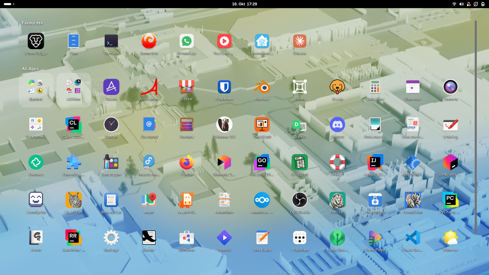
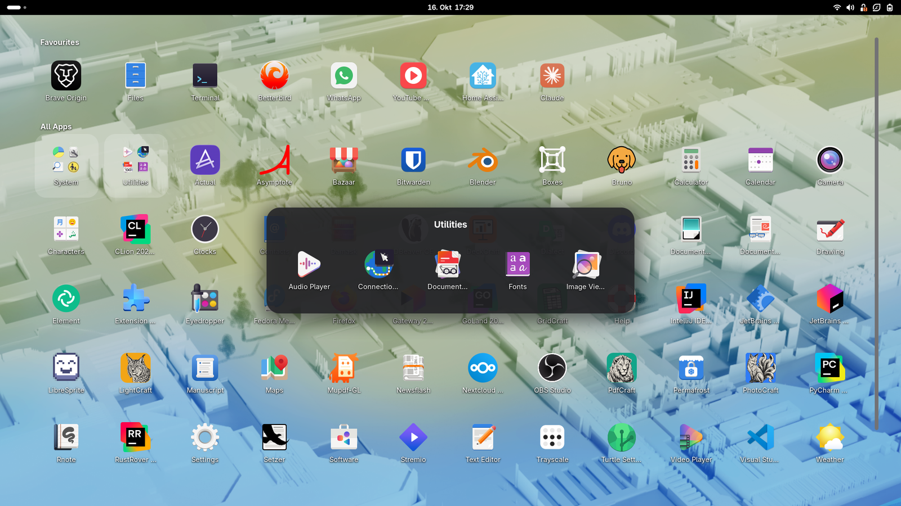
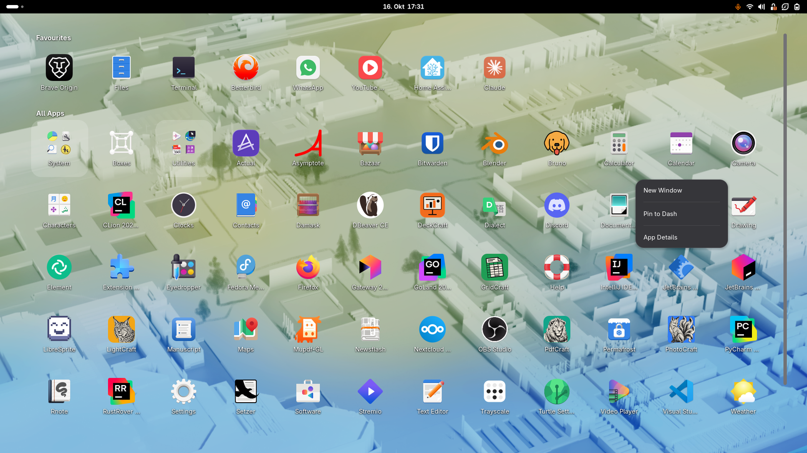
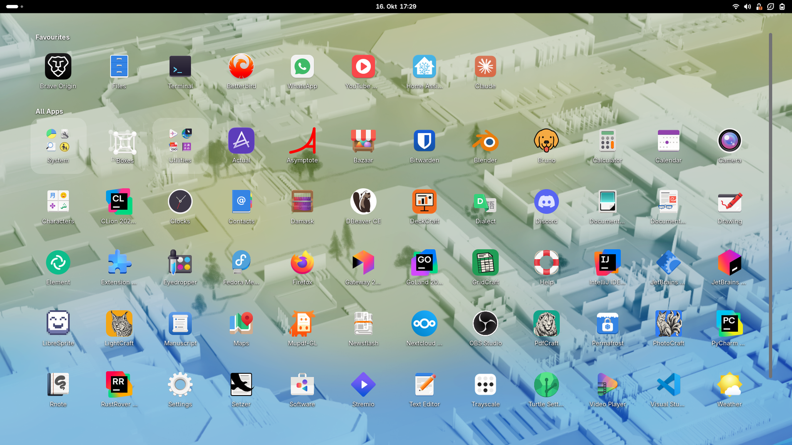
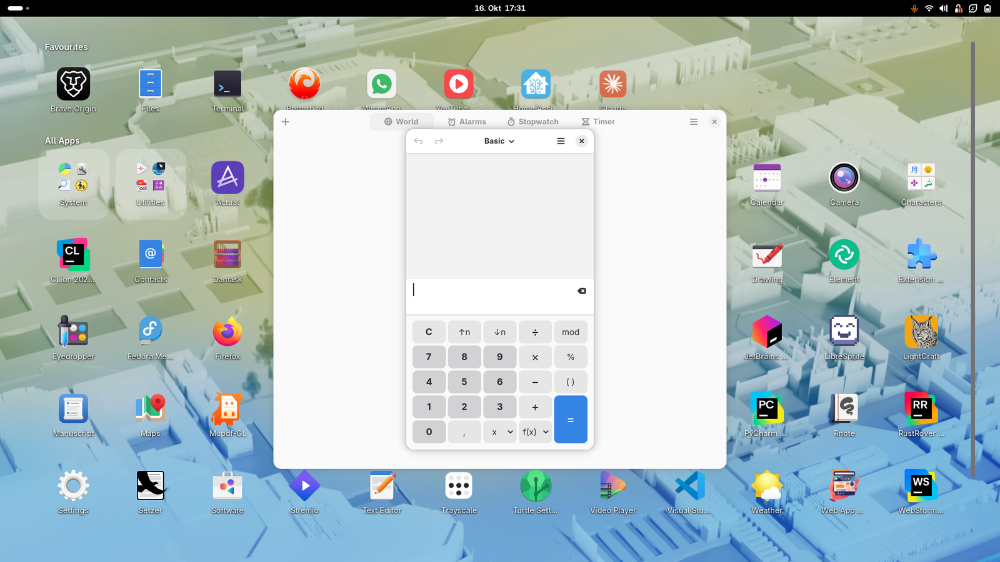

<div align="center">


# Desktop Launcher

**Your empty desktop is the app launcher.**

A GNOME Shell extension that draws your apps on the wallpaper, behind every window, like a phone home screen. Click to launch, right-click for GNOME's app menu, open folders, drag to reorder. The overview, the dash and Alt+Tab stay exactly as they are.

[](https://github.com/atayoez/desktop-launcher/releases/latest)


[](LICENSE)
[](https://paypal.me/atayozc)



</div>

## Features

| | |
|---|---|
| **Lives on the wallpaper** | The grid sits between the wallpaper and your windows. Wherever there is no window, there is your launcher; windows simply cover it. Nothing changes in the overview. |
| **Click, right-click, long-press** | Click launches or focuses an app, middle-click or Ctrl-click opens a new window. Right-click or long-press opens GNOME's own app menu: open windows, New Window, desktop actions, Pin to Dash, App Details, Quit. |
| **Folders** | Your GNOME app folders show up as folder tiles. Click one and its apps open in a panel over the grid; click outside or launch something to close it. Changes made in the overview appear immediately. |
| **Drag to reorder** | Press and hold, then drag. All Apps keeps your order, dragging in the Favourites row reorders GNOME's favourites, and dropping an app on the Favourites row pins it. |
| **No duplicates with the dock** | Pinned and running apps are already in the dock, so they stay out of All Apps and folders until unpinned or closed. |
| **Replace GNOME's app grid** | Optional: the Show Apps button, in the GNOME dash or in Dash to Panel, and Super+A minimize every window with GNOME's animation to reveal the launcher. Press again and the windows come back. |
| **Theme-native** | Tiles reuse the Shell's own icon and menu classes, so they follow your Shell theme, accent colour and icon theme. Running apps get a dot. |

<div align="center">
<table>
<tr>
<td></td>
<td></td>
</tr>
<tr>
<td align="center"><sub>Folders</sub></td>
<td align="center"><sub>Right-click menu</sub></td>
</tr>
<tr>
<td></td>
<td></td>
</tr>
<tr>
<td align="center"><sub>Drag to reorder</sub></td>
<td align="center"><sub>Behind every window</sub></td>
</tr>
</table>
</div>

## Install

**From the release zip.** Download `desktop-launcher@oezcan.me.shell-extension.zip` from the [latest release](https://github.com/atayoez/desktop-launcher/releases/latest), then:

```sh
gnome-extensions install desktop-launcher@oezcan.me.shell-extension.zip
gnome-extensions enable desktop-launcher@oezcan.me
```

**From source.** Symlinks the checkout into your extensions folder, handy for hacking on it:

```sh
git clone https://github.com/atayoez/desktop-launcher.git
cd desktop-launcher
make link enable
```

GNOME Shell only picks up a newly installed extension at login, so log out and back in once. Works on GNOME Shell 48 to 51 (developed and tested on 50, Fedora 44, Wayland).

Desktop-icon extensions such as Desktop Icons NG put a full-screen window on the desktop layer that would cover the launcher. Turn them off.

## Settings

Open with `gnome-extensions prefs desktop-launcher@oezcan.me` or from the Extensions app.

| Setting | Default | What it does |
|---|---|---|
| Icon size | 64 px | Size of the app icons |
| Show app names | on | Labels under the icons |
| Show section titles | on | "Favourites" and "All Apps" headings; hidden automatically when there is only one section |
| Favourites row | on | Dash favourites as a row above All Apps |
| Replace GNOME's app grid | off | Show Apps button and Super+A reveal the desktop instead of opening the overview grid |
| Outer margin | 48 px | Space between the grid and the edge of the work area |
| Maximum grid width | unlimited | Cap the grid width; the grid is centred |
| Show on every monitor | off | One launcher per monitor instead of the primary only |

The drag order of All Apps is stored in the `app-order` key and never needs touching by hand.

## How it works

The Shell keeps its wallpaper actors in a `Meta.BackgroundGroup` at the bottom of `global.window_group`. The extension adds one `LauncherLayer` per monitor to that group, sized to the monitor's work area. Being inside the window group puts the layer above the wallpaper and below all windows, and the overview, which draws its own backgrounds, never shows it. When the Shell recreates a wallpaper actor (wallpaper change, monitor hot-plug) it lands on top of the layer, so the extension listens for `child-added` on the group and moves itself back up.

Tiles are `St.Button`s around the Shell's `IconGrid.BaseIcon`; the context menu is the Shell's `AppMenu`. Folders are read from `org.gnome.desktop.app-folders` and resolved like the overview does: explicit `apps`, plus apps whose categories intersect the folder's `categories`, minus `excluded-apps`.

**Reordering.** Tiles are Shell DND sources and each section's grid is a drop target. While a tile is dragged over its own section the faded source tile acts as the placeholder and the grid re-attaches its children live. The drop writes `app-order`, or for the Favourites row calls `AppFavorites.moveFavoriteToPos`; dropping an All Apps tile on the Favourites row calls `addFavoriteAtPos`.

**Replacing the app grid.** Every way into the overview's app grid is redirected to `toggleDesktop()`: `Overview.show(APP_GRID)` (which is also what Dash to Panel calls), `Overview.showApps()`, the `toggle-application-view` keybinding and the dash's Show Apps toggle. The overview state is clamped to the window picker so the swipe gesture can't reach the grid either. `toggleDesktop()` minimizes the windows of the active workspace in stacking order, or restores the ones it minimized. Everything is undone when the option or the extension is turned off.

## Develop and test

Wayland can't restart the Shell, so test in a throw-away headless Shell:

```sh
make nested                             # headless Shell with a 1600x900 virtual monitor
./scripts/nested.sh 1920x1080 devkit    # or a visible window
```

The script uses its own settings file and enables a tiny helper extension that puts *that* Shell in unsafe mode, which unlocks `org.gnome.Shell.Eval` and `org.gnome.Shell.Screenshot` on its bus:

```sh
export DBUS_SESSION_BUS_ADDRESS=$(cat $XDG_RUNTIME_DIR/desktop-launcher-nested/bus)
gdbus call --session --dest org.gnome.Shell --object-path /org/gnome/Shell \
  --method org.gnome.Shell.Eval "import('resource:///org/gnome/shell/ui/main.js').then(Main => Main.overview.hide())"
gdbus call --session --dest org.gnome.Shell.Screenshot --object-path /org/gnome/Shell/Screenshot \
  --method org.gnome.Shell.Screenshot.Screenshot false false /tmp/shot.png
```

Top-level `await` is not allowed in Eval; return a promise instead. Real clicks can be injected with a virtual pointer created from Eval (`seat.create_virtual_device`), which is how the screenshots above were taken. `make zip` builds the release archive with `gnome-extensions pack`.

Two Clutter gotchas if you touch the tiles: a right-click gesture on an `St.Button` must set `recognize_on_press`, because the button's own click gesture claims the release; and a signal handler that returns `EVENT_STOP` for a press makes Clutter cancel every gesture still deciding, so the folder backdrop checks the pointer position instead of stopping events.

## Support

Desktop Launcher is free and always will be. If it makes your desktop feel like home, you can support its development:

[](https://paypal.me/atayozc)

Bug reports and ideas are welcome in [Issues](https://github.com/atayoez/desktop-launcher/issues).

## License

GPL-2.0-or-later. See [`LICENSE`](LICENSE).
