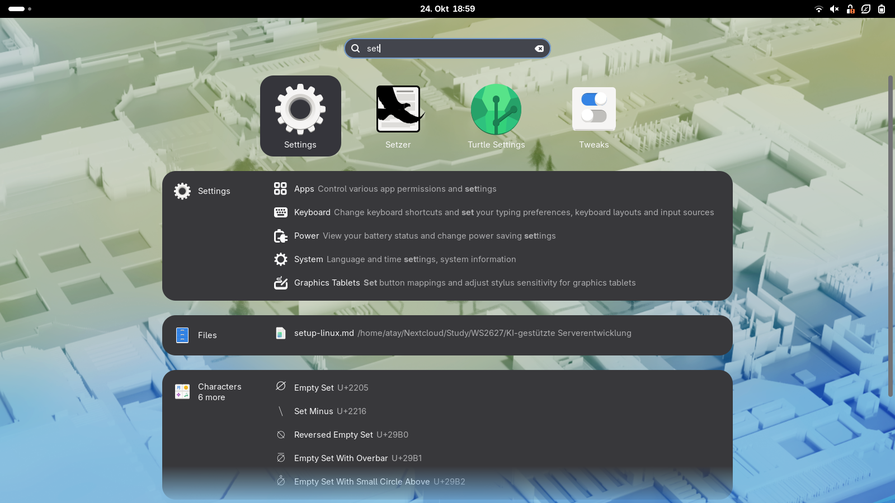

<div align="center">


# Desktop Launcher

**Your empty desktop is the app launcher.**

A GNOME Shell extension that puts GNOME's own app grid on the wallpaper, behind every window, like a phone home screen. Click to launch, right-click for GNOME's app menu, open folders, drag to reorder, type to search. The overview, the dash and Alt+Tab stay exactly as they are.

[](https://github.com/atayoez/desktop-launcher/releases/latest)


[](LICENSE)
[](https://paypal.me/atayozc)


</div>

## Features

| | |
|---|---|
| **Lives on the wallpaper** | The grid sits between the wallpaper and your windows. Wherever there is no window, there is your launcher; windows simply cover it. Nothing changes in the overview. |
| **GNOME's own app grid** | It is the overview's "Show Apps" grid itself, sized for the desktop: icons at your chosen size and as many per page as fit the screen. Pages, page arrows and dots, folders, drag and drop and keyboard paging all behave exactly like GNOME's. |
| **Click, right-click, long-press** | Click launches or focuses an app, middle-click or Ctrl-click opens a new window. Right-click or long-press opens GNOME's own app menu: open windows, New Window, desktop actions, Pin to Dash, App Details, Quit. |
| **Folders** | Your GNOME app folders show up as folder tiles. Click one and it opens in GNOME's own folder dialog, exactly as in the overview; click outside, press Escape or launch something to close it. Folders work like in GNOME's app grid: drop an app on another app to make a folder, or on a folder to put it in; rearrange apps inside an open folder by dragging; drag one out of the folder to take it out. The pencil next to the folder name renames it. Folders are GNOME's own, so the overview shows the same ones. |
| **Type to search** | Start typing on the desktop and GNOME's own search appears: apps plus every search provider (Files, Settings, Calculator, ...), exactly as in the overview. Enter opens the first result, arrows and Tab move between results, Escape closes it. There is no search button; the desktop has the keyboard whenever no window is focused or after a click on the desktop. |
| **Blur my Shell** | With [Blur my Shell](https://extensions.gnome.org/extension/3193/blur-my-shell/) installed and its popup blur on, the desktop behind the search and behind an open folder is blurred with your Blur my Shell settings, like the overview. |
| **Drag to reorder** | Press and hold, then drag, across pages too. The desktop keeps its own layout, separate from the overview's smaller pages. |
| **No duplicates with the dock** | Apps pinned to the dock stay out of the grid, as in the overview. |
| **Replace GNOME's app grid** | Optional: the Show Apps button, in the GNOME dash or in Dash to Panel, and Super+A minimize every window with GNOME's animation to reveal the launcher. Press again and the windows come back. |
| **Out of the way** | While a monitor shows any open (not minimised) app window on the current workspace, its icons fade out like they do when the overview opens, and can't be clicked by accident. Minimise or close the windows, or switch to an empty workspace, and they fade back in; with the app grid replacement on, the Show Apps button and Super+A do that for you. |
| **Always there** | The launcher stays visible while you swipe between workspaces, where GNOME otherwise paints its own copies of the wallpaper. Opening the overview, by swiping up or pressing Super, fades it out smoothly. |
| **Theme-native** | Being GNOME's own grid, folder dialog and search, everything follows your Shell theme, accent colour and icon theme. Only the labels get a soft shadow for light wallpapers. |

<div align="center">
<table>
<tr>
<td></td>
<td></td>
</tr>
<tr>
<td align="center"><sub>Folders</sub></td>
<td align="center"><sub>Right-click menu</sub></td>
</tr>
<tr>
<td></td>
<td></td>
</tr>
<tr>
<td align="center"><sub>Drag to reorder or make folders</sub></td>
<td align="center"><sub>Type to search</sub></td>
</tr>
</table>
</div>

## Install

**From the release zip.** Download `desktop-launcher@oezcan.me.shell-extension.zip` from the [latest release](https://github.com/atayoez/desktop-launcher/releases/latest), then:

```sh
gnome-extensions install desktop-launcher@oezcan.me.shell-extension.zip
gnome-extensions enable desktop-launcher@oezcan.me
```

**From source.** Symlinks the checkout into your extensions folder, handy for hacking on it:

```sh
git clone https://github.com/atayoez/desktop-launcher.git
cd desktop-launcher
make link enable
```

GNOME Shell only picks up a newly installed extension at login, so log out and back in once. Works on GNOME Shell 48 to 51 (developed and tested on 50, Fedora 44, Wayland).

Desktop-icon extensions such as Desktop Icons NG put a full-screen window on the desktop layer that would cover the launcher. Turn them off.

## Settings

Open with `gnome-extensions prefs desktop-launcher@oezcan.me` or from the Extensions app.

| Setting | Default | What it does |
|---|---|---|
| Icon size | 64 px | Size of the app icons; each page holds as many as fit |
| Replace GNOME's app grid | off | Show Apps button and Super+A reveal the desktop instead of opening the overview grid |
| Outer margin | 48 px | Space between the grid and the edge of the work area |
| Maximum grid width | unlimited | Cap the grid width; the grid is centred |
| Show on every monitor | off | One launcher per monitor instead of the primary only |

The desktop's layout (pages and positions) is stored in the `app-layout` key, in the format of GNOME's own `app-picker-layout`, and never needs touching by hand.

## How it works

The Shell keeps its wallpaper actors in a `Meta.BackgroundGroup` at the bottom of `global.window_group`. The extension adds one `LauncherLayer` per monitor to that group, sized to the monitor's work area. Being inside the window group puts the layer above the wallpaper and below all windows, and the overview, which draws its own backgrounds, never shows it. When the Shell recreates a wallpaper actor (wallpaper change, monitor hot-plug) it lands on top of the layer, so the extension listens for `child-added` on the group and moves the new wallpaper back to the bottom.

**The app grid.** Each layer holds an `AppDisplay.AppDisplay`, the class behind the overview's "Show Apps" page, so icons, folders, the app menu, drag and drop, folder creation and keyboard paging are GNOME's code. The layer only adapts it to the desktop:

- Page size: the grid normally picks one of a few fixed layouts (8×3, 6×4, ...) and grows its icons to fill it. The layer fixes the icon size (`fixed_icon_size`) and hands the grid, through its own `setGridModes`, as many columns and rows as fit the work area. Only the page arrows get room at the sides, not the overview's previews of neighbouring pages.
- Layout: the grid's `PageManager` is swapped for one that keeps the same data in this extension's `app-layout` key, because the grid keeps every app on the page it was saved on and the overview's pages are much smaller. The grid fills its pages with the default page size before the desktop size applies; once it does, a saved layout is restored, or a fresh one is filled in order and saved.
- Folder dialogs, which the grid puts into the overview's group (hidden outside the overview), are moved to the desktop, and closed when an app launches (the overview would hide instead).
- A folder preview left on an icon after a drop is cleared when the drag ends (the overview's grid keeps it too, but the overview closes).
- The grid connects to `Shell.AppSystem`, `global.settings` and the overview for good, as the overview never destroys its own; those handlers are recorded and disconnected when the extension is disabled, which happens on every screen lock.

**Workspace switch and overview.** During a workspace switch and in the overview, the Shell paints its own wallpaper copies above the window layer (`workspaceAnimation.js` and `workspace.js`), which would hide the launcher. The extension adds a live `Clutter.Clone` of the monitor's layer to each of those: into every switch-animation background group, and into each overview `Workspace` between its background and its window previews. The overview workspace's box starts out as the work area, which the layer covers exactly, and shrinks into a preview of a different aspect, so the clone is scaled uniformly to fit and centred; at full size this is an exact 1:1 mapping, so the transition starts and ends seamlessly. The switch-animation groups are the whole monitor, so there the layer sits at its offset. The clone lives beside the overview background rather than inside it, because the overview derives the workspace box from that actor's preferred size. The overview clones take their opacity from the overview's state adjustment (hidden 0 → window picker 1), which the swipe gesture and the Super key animation both drive, so the launcher fades out as the overview opens.

**Blur my Shell.** Blur my Shell has no API for other extensions. Its popup blur scans the direct children of the Shell's top-level groups (the background group is one, as a child of the window group) for actors with one of its target style classes, and blurs what is behind them with the user's popup pipeline, following their visibility, opacity and size. The search and the folder dialog carry its own marker class `bms-keyboard-surface`, which no theme styles, and are direct children of the background group above the launcher layer, so the blur lands between the launcher and them. To keep that order, the extension moves only re-created wallpaper actors to the bottom of the group instead of raising its layers to the top. This relies on Blur my Shell internals and may need updating if they change.

**Replacing the app grid.** Every way into the overview's app grid is redirected to `toggleDesktop()`: `Overview.show(APP_GRID)` (which is also what Dash to Panel calls), `Overview.showApps()`, the `toggle-application-view` keybinding and the dash's Show Apps toggle. Shifting up from the window picker, by pressing Super twice or Super+Up, shows the desktop too, and the overview state is clamped to the window picker so the swipe gesture can't reach the grid either. `toggleDesktop()` minimizes the windows of the active workspace in stacking order, or restores the ones it minimized. Everything is undone when the option or the extension is turned off.

## Develop and test

Wayland can't restart the Shell, so test in a throw-away headless Shell:

```sh
make nested                             # headless Shell with a 1600x900 virtual monitor
./scripts/nested.sh 1920x1080 devkit    # or a visible window
```

The script uses its own settings file and enables a tiny helper extension that puts *that* Shell in unsafe mode, which unlocks `org.gnome.Shell.Eval` and `org.gnome.Shell.Screenshot` on its bus:

```sh
export DBUS_SESSION_BUS_ADDRESS=$(cat $XDG_RUNTIME_DIR/desktop-launcher-nested/bus)
gdbus call --session --dest org.gnome.Shell --object-path /org/gnome/Shell \
  --method org.gnome.Shell.Eval "import('resource:///org/gnome/shell/ui/main.js').then(Main => Main.overview.hide())"
gdbus call --session --dest org.gnome.Shell.Screenshot --object-path /org/gnome/Shell/Screenshot \
  --method org.gnome.Shell.Screenshot.Screenshot false false /tmp/shot.png
```

Top-level `await` is not allowed in Eval; return a promise instead. Real clicks can be injected with a virtual pointer created from Eval (`seat.create_virtual_device`), which is how the screenshots above were taken. `make zip` builds the release archive with `gnome-extensions pack`.

## Support

Desktop Launcher is free and always will be. If it makes your desktop feel like home, you can support its development:

[](https://paypal.me/atayozc)

Bug reports and ideas are welcome in [Issues](https://github.com/atayoez/desktop-launcher/issues).

## License

GPL-2.0-or-later. See [`LICENSE`](LICENSE).
